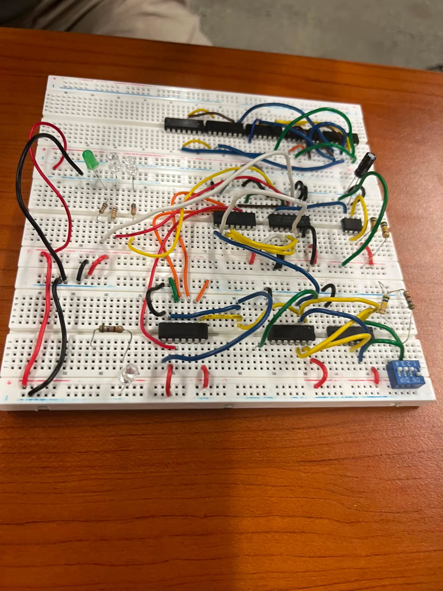

# 1D Pong — Digital Logic Game

# **Photos**

A one-dimensional version of Pong built using digital logic circuits, without a traditional CPU or software-based game engine.

I developed this project during a summer engineering program at **The Cooper Union**, where I worked on designing a playable game using fundamental digital electronics. I started by building and testing circuits in Logisim before moving toward a physical implementation using logic ICs, registers, and LEDs.

The goal was to see how much of a functioning game I could build from basic digital components.

## How It Works

Unlike traditional Pong, which takes place on a two-dimensional screen, this version uses a single row of LEDs to represent the playing field. A lit LED represents the ball, which moves back and forth between two players.

Each player has to time their input correctly to return the ball when it reaches their end of the field. Missing the ball results in a point for the opposing player.

The game is controlled entirely through digital circuitry rather than a program running on a microcontroller.

## Digital Logic

The design uses several fundamental digital components:

- **Registers:** Store the ball's current position and other game states.
- **Logic Gates:** Control movement, collisions, and game conditions.
- **Adders:** Update the ball's position as it moves across the field.
- **Comparators:** Detect when the ball reaches a player or a boundary.
- **Multiplexers:** Select between different inputs and game states.
- **Clock:** Controls the speed at which the ball moves.
- **LED Decoder:** Converts the stored ball position into the corresponding LED output.

The ball's position is represented by a binary value that changes with each clock cycle. Depending on the current direction, the circuit increments or decrements this value.

When the ball reaches either end, the circuit checks for player input to determine whether to reverse direction or register a miss.

## Development Process

I began the project by designing smaller digital logic circuits and combining them into a larger system.

The first version used a simple binary representation of the ball's position. As I developed the design, I moved toward a four-bit system that could represent more positions and handle movement in both directions.

I used Logisim to test individual components, including registers, latches, and the logic controlling the ball's movement.

After working through the simulated design, I began translating the circuit into a physical version using breadboards and individual electronic components.

One of the biggest challenges was making sure the different parts of the system operated together correctly. Problems with clock timing, register states, and LED decoding required debugging both the logic design and its physical implementation.

## What I Learned

This project gave me a much better understanding of how digital systems work at the hardware level.

In particular, I gained experience with:

- Binary arithmetic and digital number representation
- Combinational and sequential logic
- Registers and state management
- Clock signals and timing
- Circuit simulation and debugging
- Breadboard prototyping and hardware integration

The most interesting part was seeing how relatively simple circuits could be combined to produce more complicated behavior without relying on conventional software.

## Future Improvements

There are several improvements I'd like to explore:

- More reliable clock and input timing
- Adjustable difficulty through ball speed
- Improved scoring and game-reset logic
- A cleaner and more compact physical circuit
- Additional gameplay features using more complex digital logic

## Project Background

**Program:** The Cooper Union Summer Engineering Program

**Project:** 1D Pong

**Focus:** Digital electronics, logic circuit design, and hardware prototyping

This project was an opportunity to explore computer engineering from the level of individual logic gates and understand how basic digital components can work together to create a functioning system.
